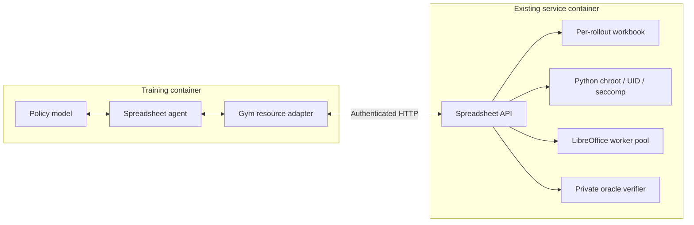

# Spreadsheet tools and LibreOffice rewards for NeMo Gym

This environment edits a persistent `data.xlsx` workbook and scores its final
answer-region values. It exposes all twelve spreadsheet tool names, including
isolated Python. The service runs in an existing **Ubuntu 24.04 x86_64 container**;
the training container calls it through its reachable IP/port. There is no nested
Docker, Kubernetes, Apptainer, model, GPU, or `verl` dependency in the service.

The implementation plan and invariants are in [DESIGN.md](DESIGN.md). The API
contracts are in [schemas.py](schemas.py). This is a **LibreOffice backend**, not
a claim of reproducing Microsoft Excel benchmark scores.

## Qualified public bundle

The [public HF runtime](https://huggingface.co/datasets/codemaivanngu/spreadsheet-gym-libreoffice-runtime)
contains a 288,364,234-byte archive built from code commit
`9dcc7e1aef517af8da352fcb7a56cf5baba28e1d`. Its immutable artifact revision is
`a4bb83d536bc3512ffa7e60bac4dcd6b0461c3d1` and SHA-256 is
`a7eee8c396f6d1ee56ac8c2748a8d1bfdaacc3b7ae47a9a63998b718ade982e9`.

Qualification passed 29 local tests, 34 Linux CPU tests, and the same 34 tests
after offline installation in a clean Ubuntu container. The Linux runs skip
Gym-specific tests (covered locally) and the non-root rejection case; local runs
skip the real Linux/XLSX dependencies. Ruff and shell syntax checks passed.
An operator-provided target-container run also passed 34 tests with the same two
expected skips after placing the isolated Python root on node-local storage.
The operator's pinned dataset run checked 8,647 tasks and kept 7,684 under this
scorer: 5,282 train and 2,402 test rows. The exclusions include observed cached
value differences and parser/reader limits; they do not all establish LibreOffice
calculation defects. The gate checks existing oracle values, not arbitrary future
policy formulas. Live model rollout, training throughput, and Excel reward
equivalence remain unverified.

Run these commands **on the service node**, using its configured company proxy:
download and extract the runtime on node-local executable storage. Dataset files
and prepared manifests may remain on shared storage.

```bash
SPREADSHEET_BUNDLE_BASE=https://huggingface.co/datasets/codemaivanngu/spreadsheet-gym-libreoffice-runtime/resolve/a4bb83d536bc3512ffa7e60bac4dcd6b0461c3d1
curl --fail --location --retry 3 "$SPREADSHEET_BUNDLE_BASE/SHA256SUMS" -o SHA256SUMS
curl --fail --location --retry 3 "$SPREADSHEET_BUNDLE_BASE/spreadsheet-gym-ubuntu24.04-x86_64.tar.gz" -o spreadsheet-gym-ubuntu24.04-x86_64.tar.gz
sha256sum -c SHA256SUMS
tar -xzf spreadsheet-gym-ubuntu24.04-x86_64.tar.gz
cd spreadsheet-gym-ubuntu24.04-x86_64
bash install_offline.sh
```

## Architecture



The adapter integrates with `SimpleResourcesServer`; a small spreadsheet agent
preserves the `simple_agent` Responses loop, cookies, token IDs, and logprobs.
It adds stable tool-call IDs in HTTP headers, an allowlist of tools, inference
execution claims, and best-effort close. The existing calculator is unchanged.

## Tool interface and supported semantics

| Tools | Behavior |
| --- | --- |
| `list_sheets`, `inspect_range`, `find_cells` | Bounded workbook inspection and text lookup |
| `write_range`, `fill_formula` | Static values and translated formula patterns |
| `format_range` | Font, fill, border, alignment, number format, row/column sizing |
| `manage_sheet` | Create, copy, rename, delete, move, hide, unhide |
| `clear_range`, `delete_rows`, `delete_columns` | Clear values or delete original-position intervals |
| `recalculate_and_read` | LibreOffice `calculateAll`, save XLSX, read cached values |
| `code_interpreter` | Fresh Python process; persistent workbook; isolated OS execution |

One task has one workbook with any number of sheets. `path` must be `data.xlsx`.
Ranges are finite A1 rectangles, bounded to 100,000 cells per range; inspection
returns at most 400 addressed records with an explicit truncation cursor. Requests
may contain up to 20 ranges. `find_cells` supports contains/equals/prefix, not
regex. Whole-row/column clear requests must be narrowed to finite rectangles.
These restrictions are explicit differences from Spreadsheet-RL's upstream tool
surface. There is no claim of complete Excel feature or task coverage.

`fill_formula`, `clear_range`, `delete_rows`, and `delete_columns` recalculate
before committing. `write_range` is static-only and does not refresh dependent
formula caches. Structural edits follow openpyxl behavior and do **not** promise
Excel-style reference repair. Renames and deletions may require explicit formula
updates. `format_range` supports a single common border style on all sides.

## Sessions, retries, and originals

- The private catalog maps `task_id` to seed/oracle paths, hashes, answer regions,
  and pinned dataset revision. These values never come from model tool arguments.
- Each rollout copies its task's `output.xlsx` to its own `data.xlsx`. GRPO samples
  of the same task use different sessions. Sources and oracle files stay untouched.
- Native and Python mutations run on staging copies. Only successful, valid XLSX
  outputs atomically replace the canonical workbook. No hard links are used.
- Operation IDs are the provider's `call_id`, outside model arguments. Repeating
  the same ID/input returns the persisted receipt; changing input is a conflict.
  Identical calls with new IDs really execute again.
- A session's operations are serialized with a filesystem lock. SQLite stores
  job/results so a lost HTTP response can be polled/retried. After a service crash,
  interrupted writes are marked indeterminate, not replayed.
- Inference claims prevent restarting the policy loop on an already-used session.
  The agent caches in-flight/completed Responses requests for five minutes (128
  entries); an agent restart loses this cache and fails closed on a prior claim.
  Do not put a static `rollout_id` in dataset rows. A caller may provide a fresh
  per-request ID for retry identification; a whole-rollout retry after execution
  begins is rejected rather than regenerating edits on mutated state.
- Verification freezes the workbook. Close stops new operations; configured TTL
  removes inactive files/receipts, including abandoned sessions. Active jobs are
  never deleted. The default retention is one day. Export diagnostic receipts or
  final files before expiry when longer retention is needed.

Keep SQLite/lock files on local persistent storage, not NFS. Run **one API process
per state root**; startup takes an exclusive owner lock. Scale with independent
replicas and session affinity. The LibreOffice pool and job queue are bounded.

## Python isolation on a restricted container

The target may be root while its enclosing seccomp policy denies user namespaces.
The default runner uses `chroot_uid_seccomp` and requires Linux root with
`CAP_SYS_CHROOT`, `CAP_SETUID`, and `CAP_SETGID`. It does not require `CAP_SYS_ADMIN`.

The builder prepares a minimal root-owned Python filesystem. Every active job gets
a different unprivileged UID and a private writable directory. The bootstrap
chroots, drops all groups/GID/UID, sets no-new-privileges and resource limits, and
installs libseccomp rules blocking network sockets, process introspection,
identity changes, mount/namespace operations, and process-group escape. Only
Python/runtime libraries are available; no `/proc`, service key, oracle, sibling
workspace permissions, or host root is exposed. Temporary files and HOME are
private per job. Remaining descendants are killed before a UID is reused.

This is process-level isolation inside one existing container, not a VM or a
kernel security proof. The service refuses startup if the actual probe fails.
Do not remove isolation checks to make the service start. A bubblewrap backend
is also available only on hosts that permit user namespaces.

## Build and install offline

Dependencies are prepared on Modal CPU using `packaging/modal_build.py`, with
explicit profile and code commit. The public bundle contains Ubuntu `.deb` files,
an offline wheelhouse, the minimal Python root, source, checksums, licenses, and a
qualification receipt. No dataset, oracle, credential, or company file is included.

On the service node, after downloading the archive and its **same-revision**
SHA256SUMS through the company proxy:

```bash
sha256sum -c SHA256SUMS
tar -xzf spreadsheet-gym-ubuntu24.04-x86_64.tar.gz
cd spreadsheet-gym-ubuntu24.04-x86_64
bash install_offline.sh
```

The installer verifies internal checksums, installs packages offline in the
existing container, creates an independent service venv, and tests chroot/UID/
seccomp on that host. It refuses to overwrite an existing venv. It does not start
the service or download dependencies. Ubuntu packages may update installed system
libraries; inspect `debs/` and the manifest before running it on a shared image.
Run it on the service container, never on the Mac or training container.

## Prepare and qualify the dataset on the service node

Download the workbook archive and one parser-specific parquet per split directly
on the service node. Pin the Hugging Face dataset commit and verify its files.
Extract the archive outside the public bundle and Python chroot. Do not include
both Hermes and Qwen-Coder versions of the same tasks.

Each training JSONL row is a flat Gym request with `agent_ref` set to
`{"name": "spreadsheet_agent", "type": "responses_api_agents"}`, plus `task_id`,
`dataset_revision`, and `responses_create_params` containing the prompt and tools.
The raw-JSONL `NemoGymDataset` wrapper places the complete row in `extra_env_info`;
do not add another `extra_env_info` wrapper to the input file. Confirm that the
active trainer still uses this contract before changing its data path.

The published `9dcc7e1` preparation code predates `agent_ref` in its output. For
already-qualified data, the standalone
[`packaging/convert_training_data.py`](packaging/convert_training_data.py) reads
`train.qualified.jsonl` and `test.qualified.jsonl` from `--input-dir` and writes
`train.jsonl`, `test.jsonl`, and a hash/count receipt under `--output-dir`. It
preserves task IDs, revisions, prompts, and tool schemas. It rejects static
rollout/session identities and conflicting agent routing. Existing converted
files are reused only when their input/output hashes match. No recalculation is
needed for this data-format correction.

With `--trainer-config`, it backs up the YAML and changes only the single
`data.train` entry's `data_path` to the converted training file. It preserves the
remaining YAML and leaves validation settings intact. Multiple training entries
are rejected rather than implicitly replacing a dataset mixture. The helper uses
only the standard library and does not install dependencies or launch training.
`--trainer-root` is required in this mode: verification uses the versioned
[`contracts/nemo_gym_raw_jsonl_v1.json`](contracts/nemo_gym_raw_jsonl_v1.json),
not an inline terminal probe. Each run saves a private receipt with script,
contract, source, input/output and YAML hashes, row counts, and backup location.

The file-based integration entrypoints and their exact arguments/receipts are
documented in [`packaging/README.md`](packaging/README.md). The source bundle
includes both `resources_servers/spreadsheet` and
`responses_api_agents/spreadsheet_agent`; a local source directory alone does not
mean the training node has installed or imported them.

To reuse the current training environment, invoke the versioned
`packaging/prepare_training_node.sh` wrapper. It sources the existing
`use_custom_opt.sh`, installs the two frontend modules/config paths, converts
data, and delegates cache reuse to the existing `copy_gym_venvs.sh`, then checks
imports. It preserves the launcher's environment layout and starts no training.

For the pinned public dataset revision
`6f274cd4cbc27e656d7ddae7c3b591669866dc84`,
[`packaging/prepare_dataset.py`](packaging/prepare_dataset.py) combines extraction,
preparation, full oracle qualification and filtering of both Hermes splits. Run
this standalone helper with the installed service Python, `PYTHONPATH` pointing
at bundled source, `--download-root` pointing at the three downloaded dataset
files, and `--work-root` pointing at node-local storage. Install bundled
`pyarrow==22.0.0` offline first. It works with the published `9dcc7e1` source;
rebuilding the runtime archive is unnecessary.

The helper verifies the pinned downloads, validates archive paths/CRCs, and
publishes completed extractions and preparation results atomically. Qualification
prints progress and checkpoints every 25 tasks by default. Rerun the same command
after interruption to reuse completed batches; keep the same helper, engine and
batch size. An interrupted batch is recalculated from original oracle copies.
Results are under `prepared-SP06/libreoffice/`: `manifest.qualified.jsonl`,
`train.qualified.jsonl`, `test.qualified.jsonl`, and `compatibility.json`. The final
`SP06_DATASET_READY` event follows a fresh check of qualified seed/oracle hashes.
This gate does not establish Excel equivalence or arbitrary future formula
compatibility. Keep reports private; the helper does not upload data or start
the service.

The following paths are examples; replace them with the node's actual paths.
Use the wheelhouse to install pyarrow into the service venv without network:

```bash
service-venv/bin/python -m pip install --no-index --find-links wheelhouse pyarrow==22.0.0
cd source
../service-venv/bin/python -m resources_servers.spreadsheet.prepare \
  --parquet /srv/spreadsheet/data/train_hermes.parquet \
  --data-root /srv/spreadsheet/data --output-dir /srv/spreadsheet/prepared \
  --revision DATASET_COMMIT

../service-venv/bin/python -m resources_servers.spreadsheet.qualify \
  --manifest /srv/spreadsheet/prepared/manifest.unqualified.jsonl \
  --data-root /srv/spreadsheet/data \
  --output /srv/spreadsheet/prepared/manifest.qualified.jsonl \
  --report /srv/spreadsheet/prepared/compatibility.json \
  --worker-root /srv/spreadsheet/qualification-workers

../service-venv/bin/python -m resources_servers.spreadsheet.filter_tasks \
  --manifest /srv/spreadsheet/prepared/manifest.qualified.jsonl \
  --input /srv/spreadsheet/prepared/train_hermes.jsonl \
  --output /srv/spreadsheet/prepared/train.qualified.jsonl
```

Missing files fail preparation by default; `--skip-missing` records exact excluded
task IDs. Qualification recalculates two independent copies of each oracle and
checks their values against the untouched original. Passing checks the oracle's
existing formulas, not every formula a future policy might generate. Unsupported
or unstable tasks are excluded explicitly. Keep the training JSONL and service
catalog aligned. The converter replaces the upstream format-specific system
prompt with the actual tool/LibreOffice contract while retaining user task text.

## Configure and run

The standalone [`packaging/start_service.py`](packaging/start_service.py) helper
can initialize private configuration, start the bundled API in a separate process
session, and save its PID/log/readiness receipts under `--service-root`. Run with
the bundled service Python and `PYTHONPATH` pointing at its source. Supply the
qualified manifest/report, dataset root, bundle path, Python-root receipt, and
advertised service URL. State and service-root must be node-local. It checks that
the URL's address belongs to this node and that the port is available before a
new launch. It reuses a live process only when the module/config path and saved
configuration/catalog hashes match. It never terminates another process or
replaces existing private keys.

When both nodes share storage, `--export-private-config SHARED_PATH` writes the
existing `gym.private.yaml` there with mode 0600. Dataset/source paths may also
be shared. The Python sandbox root and service SQLite/lock state stay local.

Readiness checks use direct TCP without inherited proxies: matching engine and
Python isolation, authenticated tool schemas, and rejection of anonymous tool
access. Startup rechecks catalog file hashes and probes both engines, so it may
take time before the port responds. A readiness receipt does not establish a
cross-container connection or completed model rollout.

Keep the Python root filesystem and service state on node-local storage. The
state directory contains SQLite databases and locks; do not put it on Lustre or
NFS. A target canary failed to execute Python from its shared filesystem after
dropping privileges, but passed with the same root copied to local storage with
clean ownership, modes, ACLs, and extended attributes. This does not establish
that every shared filesystem is mounted `noexec`.

If the offline installer has already installed dependencies and created
`service-venv`, a failed final isolation probe does not require reinstalling.
Copy the Python root to a fresh node-local directory, preserve root ownership and
the builder's directory/file modes, remove inherited ACLs and extended
attributes, and repeat the real isolation canary. Configure the service with the
local root only after that canary passes. Do not relax isolation policies to
work around filesystem execution failures.

Create private keys/config locally on the service node:

```bash
../service-venv/bin/python -m resources_servers.spreadsheet.init_service \
  --data-root /srv/spreadsheet/data \
  --manifest /srv/spreadsheet/prepared/manifest.qualified.jsonl \
  --state-root /opt/spreadsheet-gym/state --config-dir /opt/spreadsheet-gym/private \
  --python-rootfs /opt/spreadsheet-gym/python-root \
  --service-url http://SERVICE_IP:8088

../service-venv/bin/python -m resources_servers.spreadsheet.service.app \
  --config /opt/spreadsheet-gym/private/service.json
```

The service binds `0.0.0.0:8088`; advertise its routable IP to the train container.
Only the authenticated adapter should reach control/tool APIs. Keep it on the
approved private network or authenticated transport. `/health` reports startup
readiness, engine version, and isolation backend; it does not prove a training
rollout has passed. UNO uses private local pipes, not a public network port.

Copy this integration's two source directories into the matching Gym checkout on
the training node. Keep `gym.private.yaml` at a private path readable by that
node, including shared storage; never post or upload it. Load the common model
config, `configs/spreadsheet.yaml`, and this private override using the existing
Gym launch/training workflow. The adapter
needs only Gym dependencies. Configure the training dataset to the filtered Gym
JSONL. Do not point the model directly at the service's internal job API.

## Verification and errors

Reward is 1 only when all answer-region cached values match after normalization;
otherwise 0. Cell accuracy is diagnostic. Numbers/numeric strings are rounded to
two decimals; dates/times and blanks are normalized. Expected cell contents are
never returned to the model. Final assistant text does not determine the reward.
The oracle's cached values are never replaced by LibreOffice recalculation.

Malformed model arguments and failed edits return tool observations. Queue,
engine, isolation, and I/O failures are environment errors (HTTP 503 / failed
rollout), never silently zero rewards. Configure the trainer to retry/drop failed
episodes rather than treating infrastructure failures as policy mistakes.

LibreOffice workers have separate profiles, one workbook at a time, a hard
deadline, and worker replacement after failure. Macros and external-link updates
are disabled. Recalculation and final scoring share the same engine.

## Validation

```bash
# Existing Gym runtime: no dependency synchronization or installation on the Mac.
python -m pytest resources_servers/spreadsheet/tests

# Linux builder/node, after installing its already-authorized runtime:
SPREADSHEET_TEST_REAL_LO=1 SPREADSHEET_TEST_ROOTFS=/absolute/python-root \
  python -m pytest -c /dev/null resources_servers/spreadsheet/tests
```

The tests distinguish deterministic state/API doubles, Gym routing/token metadata,
real XLSX edits, real cross-sheet LibreOffice recalculation, and real chroot/
seccomp execution. The real service canary creates independent sessions, executes
Python, reads recalculated values, and checks rewards 1 and 0 against a synthetic
oracle. It is not a live policy-training run or a full dataset audit.

`packaging/modal_diagnose.py` reproduces six operator-reported qualification
failures using the cached CPU runtime and pinned public dataset. It separates
oracle/metadata reading, LibreOffice recalculation, comparison, and cell
inspection, and verifies that original oracle bytes stay unchanged. Its logs
contain oracle formulas and cached values for operator diagnosis; keep them out
of policy observations. This diagnostic does not modify a running node's source,
qualification checkpoints, or scoring contract.

## Provenance

Design references: [Spreadsheet-RL](https://github.com/Spreadsheet-RL/Spreadsheet-RL),
[its paper](https://arxiv.org/abs/2605.22642), and the local Gym `simple_agent` /
session resource examples. New workbook code is implemented here without importing
or vendoring the upstream `verl` trainer. Source follows this repository's Apache
2.0 license; redistributed runtime dependencies retain their own license notices.
